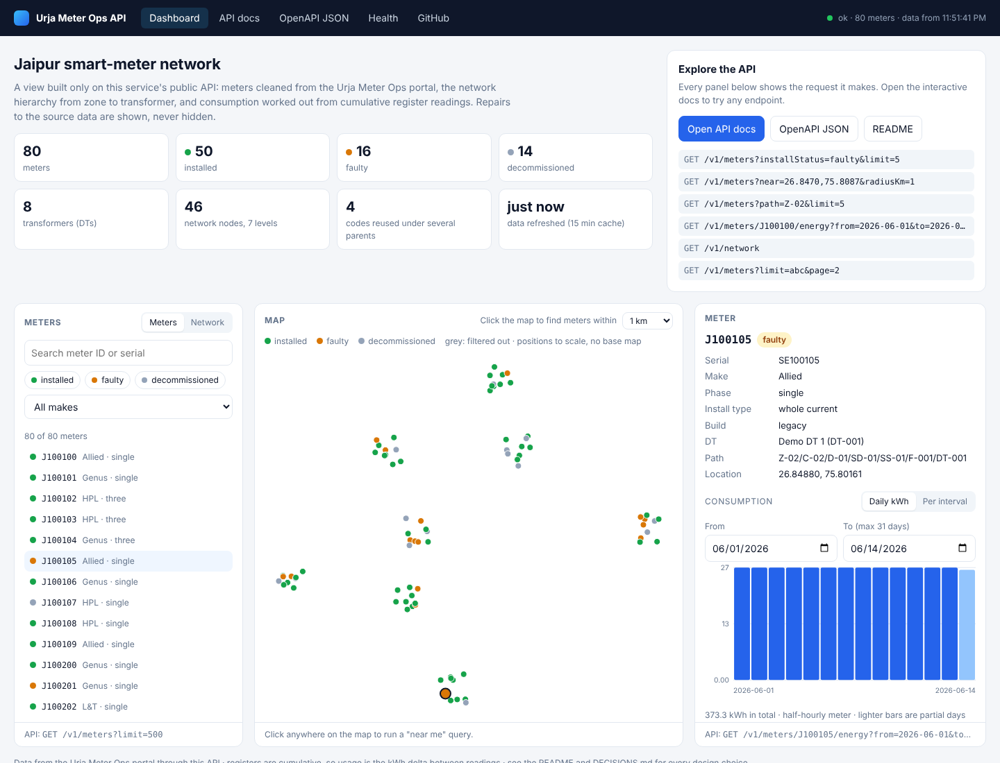

# Urja Meter Ops API

A clean, documented REST API over the **Urja Meter Ops** smart-meter portal, which has no API of its own. The service logs in to the portal the way its own UI does, pulls meters, transformers and energy readings, cleans them (real numbers, ISO 8601 timestamps, repaired hierarchy, per-interval consumption), caches them, and serves them as JSON with an OpenAPI spec and Swagger UI. Every repair to the source data is listed in the response, never hidden.

- **How the portal works:** [PROTOCOL.md](PROTOCOL.md)
- **The API contract:** [openapi.json](openapi.json) (OpenAPI 3.0.3), served as Swagger UI at `/docs`
- **Every design decision, with trade-offs:** [DECISIONS.md](DECISIONS.md) (D1 to D16)
- **A dashboard built only on the API:** `/` (see [Dashboard and API docs](#dashboard-and-api-docs))

## Quick start

Requires **Node.js 20.6 or newer** (uses built-in `fetch`, `--env-file` and the `node:test` runner).

```bash
npm install
cp .env.example .env          # Windows PowerShell: Copy-Item .env.example .env
# edit .env: PORTAL_EMAIL=operator@urja.local, PORTAL_PASSWORD=<from the assignment brief>
npm start                     # dashboard on http://localhost:3000/, interactive API docs on /docs
```

| Command | What it does |
| --- | --- |
| `npm start` | Runs the API against the live portal (settings from `.env`) |
| `npm run dev` | Same, restarting on file changes |
| `npm test` | Runs all tests (no network; the portal is faked) |
| `npm run smoke` | About 6 requests to the live portal: login, DTs, signed export, one day of energy |
| `npm run demo` | Runs the API and web client offline against a fake portal with synthetic data |

Settings (`.env`): `PORTAL_URL`, `PORTAL_EMAIL`, `PORTAL_PASSWORD`, `PORT` (3000), `PORTAL_TIMEOUT_MS` (10000), `PORTAL_MIN_INTERVAL_MS` (500).

## Endpoints

| Endpoint | What it returns |
| --- | --- |
| `GET /v1/meters` | Cleaned meters, paginated (`limit` 1 to 500, default 100; `offset`). Filters: `installStatus`, `phaseType`, `installType`, `build` (comma lists), `make`, `dt`, `path` (a network node and everything under it), `q` (meterId or serial substring), `near=lat,lng` + `radiusKm` (nearest first, with `distanceKm`) |
| `GET /v1/meters/{meterId}` | One meter (case-insensitive id) |
| `GET /v1/meters/{meterId}/energy?from=&to=` | Register readings with `kwhDelta`/`kvahDelta` and the detected `intervalMinutes`. Both dates required, at most 31 days. `granularity=daily` gives usage per IST day instead |
| `GET /v1/network` | The hierarchy tree, zone to DT, with meter counts by status per node |
| `GET /v1/transformers` | The 40 DTs with feeder, capacity, path, meter count and name aliases |
| `GET /health` | Cache and portal status (never calls the portal) |
| `GET /docs`, `GET /openapi.json` | Swagger UI and the spec |
| `GET /` | Dashboard built only on this API: summary, meter list and network tree, map with "near me", meter details and consumption chart |

Every success is `{ "data": ..., "meta": { "fetchedAt", "stale", ... } }`. Every error is `{ "error": { "code", "message", "details"? } }`.

## Dashboard and API docs



*Screenshot from `npm run demo` (synthetic data from the fake portal).*

- **Dashboard (`/`):**
    - Summary figures from `/v1/network`.
    - A meter list with search, status and make filters, and a **network tree**: click a node to list the meters under it (`?path=`).
    - A **map**: click anywhere to run a "near me" query (`?near=&radiusKm=`).
    - Meter details with their data-quality repairs, and consumption as **daily kWh or per interval**.
    - Every panel shows the exact API request it made, as a link.
- **API docs (`/docs`):** Swagger UI on the hand-written `openapi.json`, with every endpoint listed open and a filter box. "Try it out" sends requests to the same server, whatever host or port it runs on.
- **Navigation:** a shared bar on both pages links Dashboard, API docs, the OpenAPI JSON, `/health` and this repo, and shows the live service status.

## Sample requests

```bash
curl "http://localhost:3000/v1/meters/J100001/energy?from=2026-06-01&to=2026-06-01"
```

```json
{
  "data": {
    "meterId": "J100001",
    "from": "2026-06-01",
    "to": "2026-06-01",
    "granularity": "raw",
    "intervalMinutes": 30,
    "units": { "kwh": "kWh", "kvah": "kVAh", "voltageR": "V", "kwhDelta": "kWh", "kvahDelta": "kVAh" },
    "readings": [
      { "timestamp": "2026-06-01T00:00:00+05:30", "kwh": 42138.41, "kvah": 45509.49, "voltageR": 234, "kwhDelta": null, "kvahDelta": null },
      { "timestamp": "2026-06-01T00:30:00+05:30", "kwh": "...", "kvah": "...", "voltageR": "...", "kwhDelta": "...", "kvahDelta": "..." }
    ],
    "dataQuality": []
  },
  "meta": { "fetchedAt": "2026-11-04T05:30:00.000Z", "stale": false }
}
```

`kwh` is the meter's cumulative register (an odometer), not consumption; `kwhDelta` is the usage in the interval **ending** at that timestamp. The first reading of a window has no earlier reading to subtract, so its delta is `null` (D10): start the window one interval earlier to get it.

More examples:

```bash
curl "http://localhost:3000/v1/meters?installStatus=faulty&make=genus&limit=5"
curl "http://localhost:3000/v1/meters?near=26.9124,75.7873&radiusKm=1"
curl "http://localhost:3000/v1/meters?path=Z-01/C-01"
curl "http://localhost:3000/v1/meters/J100100/energy?from=2026-06-01&to=2026-06-07&granularity=daily"
curl "http://localhost:3000/v1/network"
curl "http://localhost:3000/v1/meters?limit=abc&page=2"   # 400, every problem listed
```

## Project structure

```
src/
  server.js            entry point: wires config, portal client, service, app; listens
  app.js               builds the Express app (no listening, so tests can use it)
  config.js            reads and checks environment variables once
  cache.js             in-memory cache: TTL, stale-while-revalidate, single flight, bounded size
  service.js           portal client + cache + cleaning behind plain methods
  portal/client.js     the only code that talks to the portal: login, session, signing, throttle, errors
  portal/sign.js       HMAC-SHA256 signature for the export
  domain/              pure functions, no I/O
    values.js          shared converters (strings, numbers, enums)
    normalise.js       raw export + DT list -> clean meters and transformers, repairs flagged
    energy.js          raw readings -> ISO timestamps, de-duplication, interval, deltas, daily roll-up
    network.js         meters -> hierarchy tree keyed by path
    query.js           filters and "near me" (haversine)
  http/
    routes.js          the /v1 endpoints
    validate.js        zod schemas: strict, unknown params rejected
    errors.js          one error shape; portal failures -> 404/502/503/504
public/                dashboard: index.html, plus nav.js and nav.css shared with the API docs page
docs/dashboard.png     screenshot for this README
scripts/               smoke check against the live portal; offline demo
test/                  unit, API, end-to-end and contract tests; a fake portal server
```

**How a request flows:** the route validates input with zod, then asks the service. The service reads the cache; on a miss, the cache runs a loader that calls the portal client and then the pure domain functions. Errors from anywhere end in one error handler.

## How it works, briefly

- **Getting the data (D1):** the portal's own Export button uses a signed `/portal/export` that returns all 403 meters with structured hierarchy and numeric coordinates. Reusing it (plus `/portal/dts`) loads everything in about 4 requests instead of 400+ page and detail requests, under a strict rate limit. Energy comes from `/portal/meters/{id}/energy`, the only source.
- **Freshness (D2, D11):** meters and DTs are cached for 15 minutes, energy windows that ended before today for good (a past reading does not change). An expired entry is served immediately, marked `stale`, while it refreshes in the background; parallel misses share one portal call; a failed refresh keeps the last good copy.
- **Cleaning (D3, D9):** numbers from strings, `DD/MM/YYYY HH:mm` to ISO 8601 with `+05:30`, blanks to `null`, blank hierarchy codes filled from other meters on the same DT, the official DT name over a conflicting one, corrupt duplicate readings dropped. Each content repair appears in `dataQuality` with what was done; routine format conversions are documented here and in PROTOCOL.md instead.
- **Consumption (D4):** registers plus per-interval deltas plus the detected interval, so `42138 kWh` is never mistaken for usage.
- **Hierarchy (D5):** codes repeat under different parents (61 of them), so a node is identified by its path, e.g. `Z-01/C-01/D-01`.
- **Errors (D6):** strict 400s with every problem listed; 502, 503 (with `Retry-After`) or 504 only when the portal fails and no cached copy can answer.
- **Robustness (D11, D14):** requests to the portal are spaced 500 ms apart, a 429 pauses portal calls for 30 s, sessions are renewed before the 1-hour expiry, every portal call has a timeout.

## Assumptions

- **Timezone:** portal timestamps have no offset; I assume IST (`+05:30`) because the utility is in Jaipur.
- **Registers:** `kwh` and `kvah` are cumulative; a delta is the usage in the interval ending at a reading, and a negative delta (a reset or replaced meter, not seen in the data) is reported as `null` and flagged.
- **Hierarchy codes** may be unique only within their parent, so nodes are keyed by path. If they were meant to be global, the tree shows the duplicates rather than hiding them.
- **A DT's meters share one upward chain**, which is what makes filling blank codes from DT siblings safe (and every fill is flagged).
- **The `/portal/dts` name is the official DT name** when meter records disagree.
- **Decommissioned meters with readings** are reported as they are: that is a fact about the source, not an error.
- **Past readings do not change**, so energy windows that ended before today are cached for good.

## Decisions and trade-offs

The full record, including rejected options, is in [DECISIONS.md](DECISIONS.md). The most important ones:

| Decision | Trade-off accepted |
| --- | --- |
| Signed export as the meter source (D1) | Depends on the signing scheme; all portal access lives in one module, and the detail pages are a fallback |
| In-memory cache, no database (D2) | Lost on restart and per instance; refills in about 4 requests |
| Repair and flag rather than pass through (D3) | An inferred fill could be wrong; the flag makes it visible |
| Path-keyed hierarchy (D5) | If codes were global, duplicates show instead of merging |
| Strict validation (D6) | A harmless extra param (a cache buster) gets a 400 |
| Plain JavaScript, Express 5, zod, hand-written spec (D7) | No generated types; drift is caught by a contract test instead |
| First delta of a window stays `null` (D10) | A one-day request on a daily meter shows no usage; documented |
| In-memory query layer (D13) | Linear scan; fine for thousands of meters, a database with a spatial index beyond roughly 100k |

## Testing

`npm test` runs 80 tests in about a second, with no network:

- **Unit tests:** signing (checked against an independent openssl result), the portal client (with a fake `fetch`), cleaning, energy, network, query, cache.
- **API tests:** the real app through supertest, with a fake portal client.
- **End-to-end tests:** the real app and the real portal client talking over HTTP to a **fake portal server** (`test/support/fake-portal.js`) that follows the portal's protocol, including the Origin check, the HMAC signature and its 5-minute window, 20-row pages, and JSON and HTML error quirks.
- **Contract tests:** real responses for every path in `openapi.json` are validated against the spec with ajv, so the documentation cannot drift from the code.

`npm run smoke` is the one check against the live portal (about 6 requests).

## What I skipped

- **Persistent storage:** no database; the cache refills after a restart.
- **Authentication on our own API:** anyone who can reach it can read it. In production it would sit behind an API key or the company's SSO.
- **The search and meter detail pages:** not needed, since the export covers them; kept as a documented fallback.
- **Pre-warming energy for all meters:** energy is fetched per meter on demand. A full sweep takes about 3.5 minutes under the rate limit and is only worth it for fleet-wide analytics.
- **Metrics and structured logs:** errors are logged to the console only.

## What I would improve

- Move to SQLite or Postgres with a background sync, so data survives restarts, several instances share it, and queries can use indexes (PostGIS for "near me").
- Measure the rate-limit window properly and replace the fixed 500 ms spacing and 30 s pause with a token bucket tuned to it.
- Optionally fetch one interval before `from`, so the first reading of every window gets a delta (option b of D10).
- Add request IDs, structured logging and basic metrics (portal latency, cache hit rate, 429 count).
- A Dockerfile and CI running the tests on every push.

## Reflection

**Assumptions.** The biggest one is that portal timestamps are IST; nothing in the data says so, but the utility is in Jaipur. I also assumed hierarchy codes are only unique within their parent, and that meters on one DT share the same upward chain, which is what lets me fill blank codes safely. Both are written down and every fill is flagged, so if an assumption is wrong it shows.

**Hardest part.** Getting consumption right. The portal's `kwh` is a cumulative register, not usage, and nothing says whether a meter reports every 30 minutes or once a day. Deciding what a delta means (usage in the interval ending at a reading), which day a daily reading's usage belongs to (the day before), and what happens at the edges of a window took more thought than any of the code.

**With another day.** I would add SQLite with a background sync, measure the rate-limit window instead of guessing, and offer an option to fetch one interval before the window so the first delta is never empty.

**A mistake I made.** My first timeout test never finished and was reported as cancelled: `AbortSignal.timeout()` uses a timer that does not keep Node's event loop alive, so the test process ended before the timeout fired. A running server keeps the loop alive, so only the test needed fixing, but it taught me to check why a test did not run rather than just re-running it. A second one: zod still ran my date-range check when a date like 31 February had already failed, and `Date.parse` silently rolls 31 February into March, so a client got a second, misleading error. A test caught it, and the range check now runs only on real dates.

**Self-critique.** The cache is per process and lost on restart, which is fine for this scope but would not survive real traffic or several instances. The 500 ms spacing and the 30 s pause are educated guesses from a few observations. My end-to-end tests run against a fake portal that I wrote from my own understanding of the real one, so a misunderstanding could be copied into both; the live smoke check is the guard against that, and it should run in CI on a schedule.
